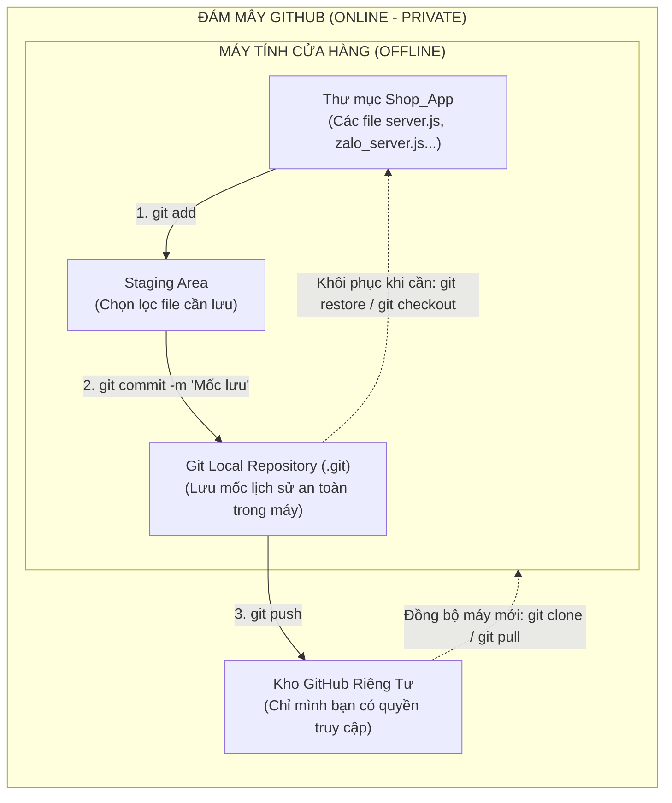

# KẾ HOẠCH TRIỂN KHAI (IMPLEMENTATION PLAN)
## Thiết lập Hệ thống Quản lý Phiên bản Git & Bảo mật Mã nguồn cho Shop_App

---

### 1. Mục tiêu & Phạm vi yêu cầu

* **Mục tiêu**:
  * Chấm dứt tình trạng mất lịch sử code mỗi khi chỉnh sửa hoặc nâng cấp tính năng.
  * Cho phép khôi phục (Rollback) về bất kỳ phiên bản nào trước đó chỉ trong 1 thao tác nếu phát sinh lỗi.
  * Giúp chủ shop dễ dàng so sánh các thay đổi (Diff) giữa các lần sửa đổi.
  * Thiết lập hàng rào bảo mật (`.gitignore`) để bảo vệ dữ liệu nhạy cảm (phiên đăng nhập Zalo, mã token, log hệ thống).
  * Chuẩn bị sẵn sàng kết nối lên GitHub (kho lưu trữ đám mây riêng tư - Private).
* **Phạm vi áp dụng**:
  * Toàn bộ mã nguồn thư mục `C:\Users\Admin\Shop_App` và thư mục con `Zalo`.

---

### 2. Kiến trúc & Luồng dữ liệu (Git Architecture)



---

### 3. Chi tiết các bước thực hiện

#### Bước 1: Cài đặt công cụ Git lên hệ điều hành Windows
* Sử dụng trình quản lý gói chính thức của Windows (`winget`) để cài đặt phiên bản Git mới nhất:
  ```powershell
  winget install --id Git.Git -e --source winget --accept-package-agreements --accept-source-agreements
  ```
* Nạp lại biến môi trường `PATH` để hệ thống nhận diện lệnh `git`.

#### Bước 2: Thiết lập cấu hình định danh cơ bản
* Cấu hình tên và email định danh người thực hiện commit (được lưu cục bộ):
  ```bash
  git config --global user.name "Gold Laundry Admin"
  git config --global user.email "admin@giatsayquynhon.vn"
  git config --global core.autocrlf true
  ```

#### Bước 3: Tạo tệp tin bảo mật `.gitignore` (BẮT BUỘC)
* Ngăn chặn tuyệt đối việc đưa các file nhạy cảm hoặc file rác nặng dung lượng vào kho lưu trữ:
  * File phiên Zalo nhạy cảm: `zalo_credentials.json`, `session.json`, `qr.png`, `temp_qr_*.png`.
  * Thư mục thư viện nặng: `node_modules/`.
  * File nhật ký hệ thống: `logs/`, `*.log`.
  * File nén dung lượng lớn: `*.rar`, `*.zip`.
  * File cache: `sent_vip_cache.json`.

#### Bước 4: Khởi tạo Git và đóng băng Mốc phiên bản ổn định đầu tiên (Initial Commit)
* Khởi tạo kho lưu trữ tại thư mục gốc:
  ```bash
  cd C:\Users\Admin\Shop_App
  git init
  git branch -M main
  git add .
  git commit -m "v1.0.0: He thong in hoa don ESC/POS & Zalo Bot Thu Ngan hoan tat merge on dinh"
  ```

#### Bước 5: Hướng dẫn kết nối GitHub (Lưu trữ đám mây)
* Hướng dẫn bạn đăng nhập/tạo tài khoản GitHub miễn phí.
* Tạo 1 kho lưu trữ riêng tư (Private Repository) trên website GitHub.
* Đẩy toàn bộ lịch sử code lên đám mây an toàn bằng lệnh:
  ```bash
  git remote add origin https://github.com/[TAI_KHOAN]/Shop_App.git
  git push -u origin main
  ```

---

### 4. Cơ chế an toàn & Khả năng tương thích

| Tiêu chí | Giải pháp đảm bảo an toàn |
| :--- | :--- |
| **Không làm gián đoạn dịch vụ** | Git hoạt động ở tầng hệ thống tập tin cục bộ, không chiếm dụng cổng mạng (Port 3000, 3001, 5050), các tiến trình PM2 vẫn chạy liên tục không bị gián đoạn dù chỉ 1 giây. |
| **Bảo mật thông tin đăng nhập** | Tệp `.gitignore` được thiết lập nghiêm ngặt, đảm bảo mật mã Zalo, Telegram Bot token hay thông tin khách hàng không bao giờ bị lộ ra ngoài. |
| **Không chiếm dụng ổ cứng** | Thư mục `node_modules` (> 200MB) và các file zip dự phòng sẽ được bỏ qua, kho lưu trữ Git cục bộ chỉ chiếm khoảng vài megabytes rất nhẹ. |

---

### 5. Kế hoạch kiểm thử & Nghiệm thu (Test Plan)

1. **Kiểm tra trạng thái bộ lọc `.gitignore`**:
   * Chạy lệnh `git status`.
   * *Kỳ vọng*: Các file nhạy cảm (`zalo_credentials.json`, `sent_vip_cache.json`, `node_modules/`) không nằm trong danh sách theo dõi.
2. **Kiểm tra mốc lưu trữ (Commit History)**:
   * Chạy lệnh `git log --oneline`.
   * *Kỳ vọng*: Hiển thị mốc commit `v1.0.0` với đầy đủ mã Hash và thời gian lưu trữ.
3. **Thử nghiệm tính năng phục hồi (Rollback Test)**:
   * Thử thay đổi 1 dòng chú thích thử nghiệm trong file `server.js`.
   * Chạy lệnh `git diff` để xem Git phát hiện dòng thay đổi.
   * Chạy lệnh `git restore server.js`.
   * *Kỳ vọng*: File `server.js` ngay lập tức trở lại trạng thái nguyên bản 100%.
