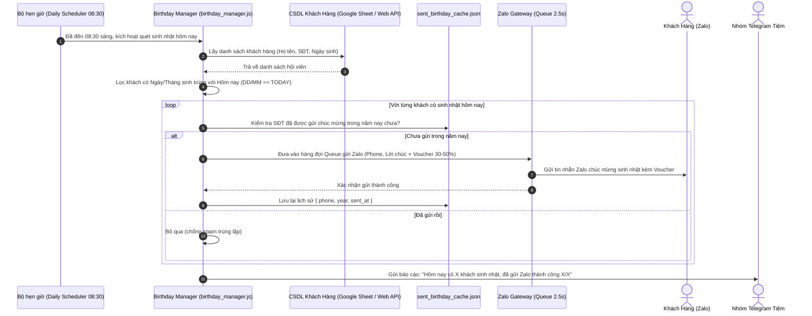

# KẾ HOẠCH TRIỂN KHAI (IMPLEMENTATION PLAN)
## Tích hợp Tự động Tìm kiếm Ngày Sinh Nhật Khách Hàng & Gửi Tin Nhắn Zalo Chúc Mừng Kèm Voucher Giảm Giá 50% Toàn Bộ Đơn Hàng

---

### 1. Mục tiêu & Phạm vi yêu cầu

* **Mục tiêu chính**:
  1. Hàng ngày vào khung giờ đầu ngày (ví dụ: **08:30 sáng**), hệ thống tự động rà soát cơ sở dữ liệu khách hàng để tìm những khách hàng có ngày sinh nhật trùng với ngày hôm nay.
  2. Tự động gửi **1 tin nhắn Zalo chúc mừng sinh nhật cá nhân hóa** tới từng khách hàng kèm theo **Voucher giảm 50% toàn bộ đơn hàng** (không giới hạn dịch vụ hay hạng thành viên) áp dụng ngay trong ngày sinh nhật hôm đó.
  3. Gửi thông báo tóm tắt danh sách khách hàng được chúc mừng sinh nhật trong ngày về nhóm **Telegram Quản trị** của tiệm để nhân viên nắm bắt khi khách ghé quầy.
  4. Cung cấp API / Nút bấm kiểm tra thủ công để quản lý có thể xem danh sách sinh nhật hôm nay và kích hoạt gửi bất cứ lúc nào.

* **Phạm vi can thiệp**:
  * Tệp tin chính: `C:\Users\Admin\Shop_App\Zalo\zalo_server.js` (Server Zalo Gateway đang hoạt động và đăng nhập tài khoản Zalo Hotline).
  * Tệp tin mới bổ sung: 
    * `C:\Users\Admin\Shop_App\Zalo\birthday_manager.js` (Module xử lý trích xuất ngày sinh, lọc danh sách hôm nay, tạo nội dung thiệp/voucher).
    * `C:\Users\Admin\Shop_App\Zalo\sent_birthday_cache.json` (Lưu lịch sử đã gửi chúc mừng sinh nhật theo từng năm, chống gửi lặp).
  * Tệp tin tài liệu kế hoạch: `C:\Users\Admin\Shop_App\ke_hoach_chuc_mung_sinh_nhat_zalo.md`.

---

### 2. Kiến trúc & Luồng dữ liệu (Architecture & Data Flow)



---

### 3. Chi tiết các bước thực hiện

#### Bước 1: Sao lưu mã nguồn an toàn
* Tạo file sao lưu:
  `C:\Users\Admin\Shop_App\Zalo\backup\zalo_server_backup_birthday_[TIMESTAMP].js` trước khi can thiệp bất kỳ dòng code nào.

#### Bước 2: Thiết kế Module Quản lý Sinh nhật (`birthday_manager.js`)
* **Thuật toán chuẩn hóa ngày sinh**:
  Hỗ trợ nhận diện mọi định dạng ngày sinh mà khách hàng hoặc nhân viên nhập vào:
  * `DD/MM/YYYY` (ví dụ: `26/10/1995`)
  * `DD/MM` (ví dụ: `26/10`)
  * `YYYY-MM-DD` (ví dụ: `1995-10-26`)
  * `DD-MM-YYYY` hoặc `D/M`
  So khớp chính xác ngày và tháng hiện tại theo giờ Việt Nam (GMT+7).
* **Nguồn nạp danh sách khách hàng**:
  * Tích hợp lấy trực tiếp từ Webapp Thẻ Thành Viên của tiệm:
    `GET https://giatsayquynhon.vn/the/api.php?action=get_members_dashboard&pin=[ADMIN_PIN]&filter=all&limit=1000`
  * Mã PIN quản trị được lưu an toàn trong file cấu hình nội bộ `birthday_config.json` (không đẩy lên Git).
  * Trích xuất các trường: `phone`, `customer_name`, `dob` (ngày sinh) của từng hội viên.

#### Bước 3: Quản lý Cache Chống Spam Theo Năm (`sent_birthday_cache.json`)
* Cấu trúc file cache:
  ```json
  {
    "0987654321_2026": {
      "phone": "0987654321",
      "customer_name": "Nguyễn Văn A",
      "year": 2026,
      "sent_at": "2026-10-26T08:30:15+07:00"
    }
  }
  ```
* Cơ chế khóa kép `(Số điện thoại + Năm)`: Đảm bảo khách hàng chỉ nhận đúng 1 tin nhắn duy nhất trong ngày sinh nhật của năm đó, dù hệ thống có khởi động lại nhiều lần trong ngày.

#### Bước 4: Thiết kế Mẫu Tin Nhắn Zalo Chúc Mừng Sinh Nhật & Voucher
Mẫu tin nhắn được tinh chỉnh bố cục chuyên nghiệp, ngắn gọn, dùng các biểu tượng emoji sinh động:

```text
🎂 GOLD LAUNDRY KÍNH CHÚC MỪNG SINH NHẬT [TÊN KHÁCH]! 🎉

Gold Laundry (282 Diên Hồng) thân gửi tới Quý khách lời chúc tuổi mới luôn ngập tràn niềm vui, nhiều sức khỏe, may mắn và hạnh phúc! 🌷

🎁 MÓN QUÀ SINH NHẬT ĐẶC QUYỀN DÀNH TẶNG BẠN:
👉 VOUCHER GIẢM 50% ĐƠN HÀNG (DÙNG 1 LẦN DUY NHẤT)!
(Áp dụng giảm 50% cho 01 đơn hàng bất kỳ: giặt sấy, sấy gấp, giặt chăn ga mền khi ghé tiệm hoặc đặt giao nhận)

• Mã ưu đãi: SINHNHAT50-[SĐT]
• Thời hạn áp dụng: Đến hết ngày [NGÀY_CUỐI_THÁNG] (Trong suốt tháng sinh nhật)
• Điều kiện: Áp dụng 01 lần duy nhất trong tháng sinh nhật

Quý khách chỉ cần đọc SĐT hoặc đưa tin nhắn này cho thu ngân khi gửi đồ để được giảm giá 50% trực tiếp trên hóa đơn nhé!

👉 Xem chi tiết thẻ thành viên & tích điểm tại:
giatsayquynhon.vn/the

Hotline hỗ trợ: 0777 77 97 11
Kính chúc Quý khách một ngày sinh nhật thật ấm áp và ý nghĩa! 💖
```

> [!IMPORTANT]
> * **Chính sách ưu đãi**: Áp dụng giảm giá **50% cho 01 đơn hàng** trong suốt tháng sinh nhật của khách hàng (đến hết ngày cuối cùng của tháng sinh nhật), sử dụng **01 lần duy nhất** theo đúng yêu cầu điều chỉnh của bạn.
> * **Báo cáo Telegram**: Thông báo đầy đủ danh sách khách sinh nhật hôm nay kèm số lượng tin nhắn đã gửi thành công.

#### Bước 5: Tích hợp Bộ Lập Lịch Tự Động (Daily Cron) & Báo cáo Telegram
1. **Lập lịch chạy tự động**:
   * Sử dụng hàm kiểm tra định kỳ mỗi sáng lúc **08:30**.
   * Toàn bộ tin nhắn gửi qua hàng đợi `enqueueTask()` giãn cách **2.5 giây/khách**, đảm bảo tuyệt đối an toàn cho tài khoản Zalo Hotline, không lo bị checkpoint hay chặn gửi tin.
2. **Báo cáo về Telegram Bot**:
   * Khi hoàn tất, bot tự động gửi 1 tin nhắn vào nhóm Telegram Quản lý:
     `🎂 [SINH NHẬT HÔM NAY - 26/10]: Đã gửi lời chúc + Voucher 30% tới 3 khách hàng: 1. Anh Nam (0905xxx), 2. Chị Lan (0914xxx), 3. Bạn Hùng (0988xxx).`

#### Bước 6: Xây dựng các Endpoint API Quản Trị
Bổ sung vào `zalo_server.js`:
* `GET /api/birthday/today`: Trả về danh sách khách sinh nhật hôm nay, trạng thái đã gửi hay chưa.
* `POST /api/birthday/send-now`: Nút kích hoạt gửi ngay lập tức (phục vụ kiểm tra trực tiếp hoặc gửi thủ công từ trang quản lý).

---

### 4. Cơ chế an toàn & Khả năng tương thích

| Tiêu chí | Giải pháp đảm bảo an toàn |
| :--- | :--- |
| **Không ảnh hưởng Google Sheet & AppSheet** | Tính năng chỉ đọc dữ liệu khách hàng (Read-only), không chỉnh sửa cột hay ghi đè lên file Google Sheet và AppSheet đang hoạt động. |
| **Không làm nghẽn máy in hay Webhook quầy** | Toàn bộ quá trình quét sinh nhật chạy vào 8h30 sáng trong luồng nền (Background Task), hoàn toàn độc lập với các cổng in hóa đơn và AppSheet Webhook. |
| **Bảo vệ tài khoản Zalo Hotline** | Áp dụng Queue giãn cách 2.5s có sẵn trên Gateway, tuân thủ nghiêm ngặt chính sách chống spam của Zalo. |
| **Chống gửi lặp phiền khách hàng** | Cache `sent_birthday_cache.json` lưu dấu `(phone_year)` ngăn chặn việc gửi lại lần thứ 2 trong cùng 1 ngày sinh nhật. |

---

### 5. Kế hoạch kiểm thử & Nghiệm thu (Test Plan)

1. **Kiểm tra trích xuất & lọc ngày sinh**:
   * Tạo dữ liệu test giả định có ngày sinh là ngày hôm nay với nhiều định dạng (`26/10`, `26/10/1998`, `1998-10-26`). Đảm bảo hệ thống nhận diện đúng 100%.
2. **Kiểm tra gửi Zalo thực tế với số điện thoại thử nghiệm**:
   * Thêm số điện thoại của Admin vào danh sách test sinh nhật hôm nay -> Kích hoạt endpoint `/api/birthday/send-now`.
   * Kiểm tra giao diện tin nhắn nhận được trên Zalo (bố cục rõ ràng, hiển thị đúng tên, đúng voucher).
3. **Kiểm tra tính năng chống gửi lặp**:
   * Gọi lại lệnh kích hoạt lần 2 -> Hệ thống phải báo: *"Đã gửi trước đó, tự động bỏ qua"*.
4. **Kiểm tra báo cáo Telegram**:
   * Xác nhận bot Telegram gửi đầy đủ thông báo tóm tắt về nhóm quản lý sau khi hoàn thành.
5. **Đồng bộ mã nguồn Git**:
   * Chạy tự động `git add .`, `git commit` và `git push` theo đúng quy tắc dự án.
