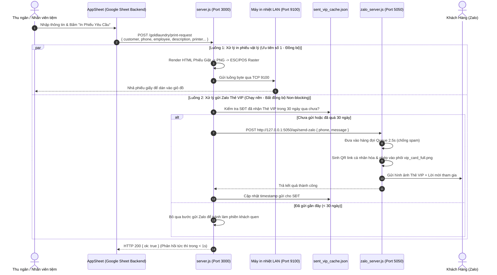

# KẾ HOẠCH TRIỂN KHAI (IMPLEMENTATION PLAN)
## Tích hợp Tự động gửi Thẻ VIP Zalo khi In Phiếu Yêu Cầu Giặt Ủi (`POST /goldlaundry/print-request`)

---

### 1. Mục tiêu & Phạm vi yêu cầu

* **Mục tiêu chính**: Khi nhân viên tại quầy nhận đồ và ấn in phiếu yêu cầu giặt ủi từ AppSheet (`POST /goldlaundry/print-request`), hệ thống sẽ **đồng thời và tự động**:
  1. Điều khiển máy in nhiệt tại quầy in phiếu yêu cầu giặt ủi (gắn lên sọt/bao đồ).
  2. Gửi ngay **1 bức ảnh Thẻ VIP cá nhân hóa** (kèm mã QR mở thẻ điện tử) và **lời chào/mời đăng ký thành viên** trực tiếp vào tài khoản Zalo của khách hàng thông qua số điện thoại trên đơn.
* **Phạm vi can thiệp**:
  * Tệp tin chính: `C:\Users\Admin\Shop_App\server.js` (xử lý webhook in ấn và kết nối luồng gửi Zalo ngầm).
  * Tệp tin phối hợp: `C:\Users\Admin\Shop_App\Zalo\zalo_server.js` (đã có sẵn API `/api/send-zalo` tại cổng 5050 tiếp nhận lệnh tạo và gửi Thẻ VIP an toàn).
  * File lưu cache: `sent_vip_cache.json` (quản lý lịch sử gửi, chống gửi lặp cho khách quen).

---

### 2. Kiến trúc & Luồng dữ liệu (Architecture & Data Flow)



---

### 3. Chi tiết các bước thực hiện

#### Bước 1: Sao lưu mã nguồn an toàn
* Tạo bản sao lưu dự phòng:
  `C:\Users\Admin\Shop_App\backup\server_backup_[TIMESTAMP].js` trước khi thực hiện bất kỳ chỉnh sửa nào.

#### Bước 2: Xây dựng cơ chế Quản lý Cache Chống Spam (`sent_vip_cache.json`)
* Tạo tiện ích quản lý lịch sử gửi thẻ VIP theo số điện thoại:
  * Nếu khách hàng mới hoặc đã nhận thẻ VIP cách đây hơn 30 ngày: Cho phép gửi và lưu lại thời gian gửi hiện tại.
  * Nếu khách hàng là khách quen (vừa nhận thẻ trong vòng 30 ngày): Bỏ qua gửi Zalo, chỉ thực hiện in phiếu giặt.

#### Bước 3: Cập nhật endpoint `POST /goldlaundry/print-request` trong `server.js`
* Trích xuất thông tin: `const phone = req.body.phone || req.body.customer_phone;` và `const customer = req.body.customer || "";`.
* Chuẩn hóa số điện thoại về định dạng 10 số hợp lệ (`0xxxxxxxxx`).
* Kích hoạt hàm gửi ngầm bằng `setImmediate` hoặc Promise không đồng bộ (không `await` chặn luồng phản hồi của máy in).
* Thiết lập nội dung lời mời thành viên:
  ```text
  ✨ GIẶT SẤY GOLD LAUNDRY KÍNH CHÀO [TÊN KHÁCH]! ✨
  Cảm ơn Quý khách đã tin tưởng gửi đồ tại tiệm hôm nay!
  Tiệm thân gửi tặng Quý khách THẺ THÀNH VIÊN VIP ĐIỆN TỬ:
  👉 Chạm vào đây để mở Thẻ VIP và xem tiến độ giặt: https://giatsayquynhon.vn/the/?phone=[SĐT]
  Hotline hỗ trợ: 0777 77 97 11. Kính chúc Quý khách một ngày tốt lành!
  ```

#### Bước 4: Tái khởi động và giám sát tiến trình qua PM2
* Tái khởi động tiến trình in ấn: `pm2 restart app` (tiến trình quản lý `server.js`).
* Giữ nguyên tiến trình `zalo` đang chạy ổn định tại cổng 5050/3001.

---

### 4. Cơ chế an toàn & Khả năng tương thích

| Tiêu chí | Giải pháp đảm bảo an toàn |
| :--- | :--- |
| **Không ảnh hưởng AppSheet & Google Sheets** | Không thay đổi cấu trúc bảng, không đòi hỏi sửa đổi Webhook trên AppSheet. Payload hiện tại của AppSheet gửi sang vẫn giữ nguyên 100%. |
| **Tốc độ in tại quầy không bị chậm trễ** | Luồng in phiếu giữ nguyên thời gian phản hồi tức thì (< 1 giây). Luồng Zalo chạy tách biệt trong background, máy in không phụ thuộc vào tình trạng mạng Zalo. |
| **Chống khóa tài khoản Zalo Hotline** | Lệnh gửi từ máy in được nạp vào chung hàng đợi `Queue 2.5s` của `zalo_server.js`, đảm bảo giãn cách gửi tin an toàn theo thuật toán chống checkpoint của Zalo. |
| **Chống làm phiền khách hàng (Anti-Spam)** | Cơ chế Cache 30 ngày ngăn việc khách mang đồ tới giặt nhiều lần trong tuần bị nhận lại cùng một thông báo. |

---

### 5. Kế hoạch kiểm thử & Nghiệm thu (Test Plan)

1. **Kiểm tra tính độc lập của máy in**:
   * Gửi request in thử nghiệm không có số điện thoại hoặc số điện thoại giả định.
   * *Kỳ vọng*: Máy in tại quầy vẫn in phiếu bình thường, server không báo lỗi.
2. **Kiểm thử gửi Thẻ VIP thực tế**:
   * Gọi mô phỏng lệnh in phiếu yêu cầu với SĐT người quản trị: `0374705746`.
   * *Kỳ vọng*:
     * Máy in nhận lệnh in phiếu yêu cầu.
     * Tài khoản Zalo `0374705746` nhận được hình ảnh Thẻ VIP sắc nét kèm mã QR và tin nhắn chào mừng.
3. **Kiểm thử cơ chế chống gửi lặp (Anti-Spam)**:
   * Ngay lập tức gọi lại lệnh in lần thứ 2 với cùng số `0374705746`.
   * *Kỳ vọng*: Máy in vẫn in phiếu lần 2, nhưng Zalo không gửi lại tin nhắn Thẻ VIP (log ghi nhận: *Đã gửi trong vòng 30 ngày, bỏ qua*).
4. **Kiểm tra nhật ký hệ thống**:
   * Kiểm tra log PM2: `app-out.log` và `zalo-out.log` đảm bảo không có cảnh báo unhandled exception hay rò rỉ bộ nhớ.
